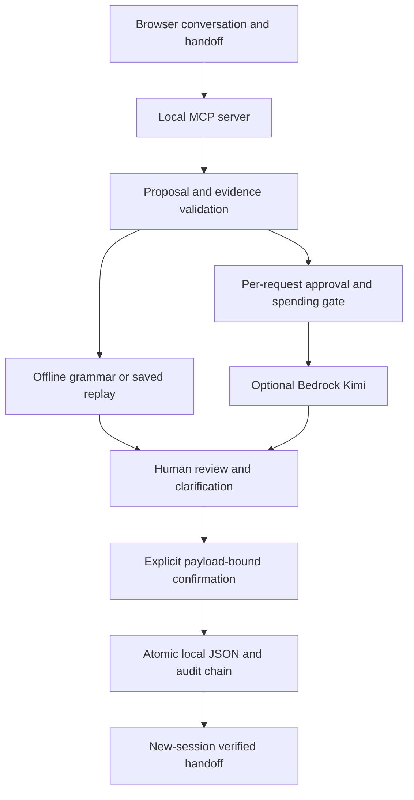

# Architecture

The browser calls the local MCP 2025-11-25 Streamable HTTP endpoint. The server maintains session-bound conversation routing. ProductController wraps the existing application controller; the proposal, consent and persistence model is preserved.

Interpretations cannot directly mutate confirmed responsibilities. Evidence spans must quote the message, while first-person identity comes from separate caller metadata. Offers and ambiguous owners remain unresolved. Unsupported fields are rejected or quarantined for human review. Corrections retain history and invalidate previous previews. Handoff answers are assembled from persisted records, not ungrounded generated prose.

The optional model transport is AWS Bedrock Runtime Chat Completions with temporary SSO credentials, SigV4 signing, `reasoning_effort: low`, maximum 1,600 completion tokens and no retries. It makes no subscription or infrastructure calls. Request bytes/input context and estimated usage are bounded.

The reusable MIT `carerelay/packages/mcp-consent-audit` package supplies single-use actor/payload-bound consent and hash-linked audit entries. Local atomic rename handles transient Windows sharing failures without repeating a transaction or inference. One application writer owns the data file.

There is no Lambda, API Gateway, DynamoDB, S3 or deployed service in this release. A cloud deployment is not required to run this simulator. The MCP listener is loopback-only in normal operation; this is not a hardened public hosting configuration.
